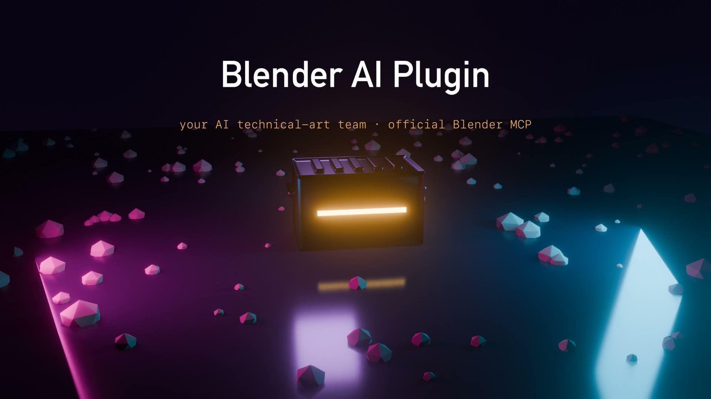
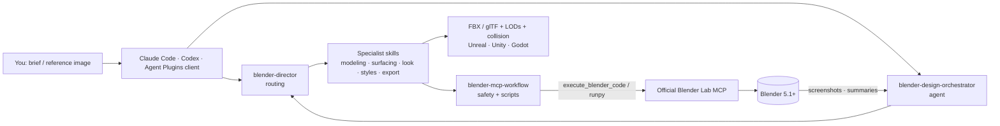

# Blender AI Plugin

[](LICENSE)
[](https://code.claude.com/docs/en/plugins)
[](https://agent-plugins.org/)
[](#-skill-categories)
[](https://www.blender.org/lab/mcp-server/)


**Your AI technical-art team inside Blender.** 95 skills, 29 tested `bpy` scripts and a design
orchestrator agent that drive the [official Blender Lab MCP server](https://www.blender.org/lab/mcp-server/):
it models, unwraps, textures, lights, grades, validates and exports game-ready assets for Unreal, Unity and
Godot, in any of 40+ art styles. Works with Claude Code, Codex and any [Agent Plugins](https://agent-plugins.org/)
client.

[](docs/blender-ai-plugin.mp4)

<sub>▶ [Watch the 30-second demo](docs/blender-ai-plugin.mp4). Every frame was rendered by Blender running this
plugin's own scripts ([source](docs/video/)).</sub>

---

## Quick Start

### Standards

This plugin follows the [Agent Plugins](https://agent-plugins.org/) v1.0.0 packaging standard (root
[`plugin.json`](./plugin.json), validated against the official schema), and its skills follow the
[Agent Skills](https://agentskills.io/) spec (`skills/<name>/SKILL.md`). It also ships native manifests:

| Manifest | Read by |
|----------|---------|
| [`plugin.json`](./plugin.json) | Any Agent Plugins client |
| [`.claude-plugin/plugin.json`](.claude-plugin/plugin.json), [`marketplace.json`](.claude-plugin/marketplace.json) | Claude Code |
| [`.codex-plugin/plugin.json`](.codex-plugin/plugin.json), [`.agents/plugins/marketplace.json`](.agents/plugins/marketplace.json) | Codex, Copilot CLI |

### 1. Connect Blender (official MCP)

1. Install **Blender 5.1+** and the [Blender Lab MCP server](https://www.blender.org/lab/mcp-server/) add-on.
2. Register the server with your agent:
   ```bash
   claude mcp add --scope user blender -- uv run --directory ~/.blender-mcp/<version>/server blender-mcp
   ```
3. In Blender, start the MCP add-on, then ask your agent: *"Summarize the objects in my Blender scene"*.

Full guide, including Codex, `.mcpb`, pip and troubleshooting: **[docs/BLENDER_MCP_SETUP.md](docs/BLENDER_MCP_SETUP.md)**

### 2. Install the plugin

#### Option 1: CLI Install (Recommended)

Use [npx skills](https://github.com/vercel-labs/skills) to install the skills directly:

```bash
# Install the skills
npx skills add proyecto26/blender-ai-plugin

# List available skills
npx skills add proyecto26/blender-ai-plugin --list
```

#### Option 2: Claude Code Plugin

```bash
# Add the marketplace
/plugin marketplace add proyecto26/blender-ai-plugin

# Install the plugin (skills + blender-design-orchestrator agent)
/plugin install blender-ai-plugin --marketplace proyecto26/blender-ai-plugin
```

#### Option 3: Codex

```bash
codex plugin marketplace add proyecto26/blender-ai-plugin
codex plugin add blender-ai-plugin@blender-ai-plugin-marketplace
```

#### Option 4: Clone and Copy

```bash
git clone https://github.com/proyecto26/blender-ai-plugin.git
cp -r blender-ai-plugin/skills/* .claude/skills/
```

#### Option 5: Git Submodule

```bash
git submodule add https://github.com/proyecto26/blender-ai-plugin.git .claude/blender-ai-plugin
```

Then reference the skills from `.claude/blender-ai-plugin/skills/`.

#### Option 6: Fork and Customize

1. Fork this repository
2. Customize or add skills for your studio's pipeline ([CONTRIBUTING.md](CONTRIBUTING.md))
3. Load your fork with `claude --plugin-dir ./blender-ai-plugin`

### 3. Build your first asset

```
"Build a game-ready sci-fi supply crate for Unreal, 2k tris, worn PBR, and show me a turntable"
```

The **blender-director** skill plans the pipeline. For big jobs the **blender-design-orchestrator** agent
runs it end to end: brief → route → setup → build → look → validate → optimize → deliver. It takes a
screenshot after every step.

---

## Features

### Executes in Blender, verified

Every skill acts through the official MCP (`execute_blender_code`, `get_objects_summary`,
`get_screenshot_of_area_as_image`, ...) instead of describing UI clicks. After each step the agent captures the
viewport and checks the result against the brief.

### 29 tested `bpy` scripts

Skills are **self-contained**: each one carries its own `references/` and, where it helps, `scripts/`.
Every script takes JSON args, returns a JSON-safe dict, never deletes user data, and passes
[`tests/blender/test_skill_scripts.py`](tests/blender/test_skill_scripts.py) on Blender 5.2 LTS.

| Area | Scripts |
|------|---------|
| Scene & QA | `scene_audit`, `setup_collections`, `validate_asset`, `capture_views`, `topology_report`, `rig_check` |
| Modeling | `bevel_stack`, `scatter_points` (Geometry Nodes), `voxelize`, `optimize_mesh` |
| Surfacing | `pbr_material`, `toon_material`, `uv_unwrap_check`, `bake_maps`, `ps1_look` |
| Look | `light_rig` (6 presets), `camera_rig`, `iso_camera`, `render_preset`, `comp_grade` (5 grades), `turntable` |
| Simulation | `rigid_body_setup`, `cloth_setup` |
| Game pipeline | `generate_lods`, `make_collision`, `export_asset`, `export_unreal`, `export_unity`, `export_godot` |

### Blender 5.x-correct

The guidance tracks the current API: Smooth by Angle instead of Auto Smooth, compositor Glare instead of
EEVEE bloom, `scene.compositing_node_group`, the new Principled BSDF socket names, AgX looks and
`modifier.properties.inputs` for Geometry Nodes. See
[`blender-5-api-notes.md`](skills/blender-mcp-workflow/references/blender-5-api-notes.md).

### Safe by default

Agents inspect the scene before changing it, work in named collections, never delete user data without
asking, and test destructive operations in background Blender (`execute_blender_code_for_cli`). This is a
real concern because MCP code runs with your user permissions.

---

## Usage Examples

```
# Hard-surface hero prop
"Build a game-ready sci-fi rifle for Unreal Engine, 3k tris, realistic PBR"
→ blender-director → hard-surface → uv-workflow → materials → asset-optimization → unreal-export

# Environment kit
"Create a modular horror corridor kit: narrow, flickering fluorescent, Silent Hill feel"
→ blender-director → horror-style → environment-artist → lighting → export-pipeline

# Character
"Retopologize this creature sculpt for game animation, 15k triangle budget"
→ blender-director → retopology → uv-workflow → texture-workflow → rigging

# Reference match
"Match this concept art: industrial spaceship. Analyze first, then build it"
→ blender-director → reference-image-match → camera match → geometry tiers → screenshot compare loop

# Style pass
"Make this scene look like a PS1 survival-horror game"
→ psx-horror-style → lowpoly-style (ps1_look.py) → lighting (horror_practical) → compositing (horror_vhs)
```

### 🎨 Skill Categories

| Category | Skills |
|----------|--------|
| **Orchestration** | [blender-director](skills/blender-director/), [blender-mcp-workflow](skills/blender-mcp-workflow/), agent [blender-design-orchestrator](agents/blender-design-orchestrator.md) |
| **Modeling** | blender-modeler, hard-surface, prop-artist, vehicle-artist, environment-artist, vegetation-artist, character-artist, creature-artist, character-archetypes |
| **Production** | sculpting, retopology, uv-workflow, materials, texture-workflow, hair-groom, cloth-sim, lookdev |
| **Technical** | geometry-nodes, lighting, camera-cinematography, rendering, compositing, animation, rigging, vfx-fx, physics-sim |
| **Pipeline** | procedural-modeling, scene-assembly, set-dressing, asset-optimization, lod-pipeline, collision-proxy, export-pipeline, unity-export, unreal-export, godot-export, qa-review, archviz |
| **Core styles** | horror, psx-horror, lowpoly, anime, voxel, isometric, stylized, realistic |
| **Extended styles** | cartoon, comic-book, manga, pixel-art, hand-painted, painterly, stop-motion-craft, chibi, noir, minimalist, vector, retro-8bit, retro-16bit, hd-2d, frutiger-aero |
| **Horror packs** | cosmic-eldritch, body-horror, analog-found-footage, liminal-space, folk-horror, mascot-puppet, dream-weirdcore, indie-horror-aesthetics |
| **Worlds / moods** | fantasy, sci-fi-punk, historical, apocalypse, biome, cozy-wholesome, dark-gritty, dream-surreal, neon-retrofuturism, brutalist |
| **Genre direction** | action-combat, shooter, rpg, survival, stealth, puzzle-platformer, metroidvania-roguelike, soulslike, strategy-sim, racing-sports, narrative-vn, card-party-idle, open-world-sandbox |
| **Eras** | visual-console-eras |

Decision trees and workflow combinations: **[docs/SKILLS_GUIDE.md](docs/SKILLS_GUIDE.md)**.

---

## Project Structure

```
blender-ai-plugin/
├── plugin.json                    # Agent Plugins 1.0 manifest
├── .claude-plugin/                # Claude Code manifest + marketplace
├── .codex-plugin/                 # Codex manifest
├── .agents/plugins/               # Codex / Copilot marketplace catalog
├── agents/
│   └── blender-design-orchestrator.md
├── skills/                        # 95 self-contained skills
│   ├── blender-director/          # routing brain
│   ├── blender-mcp-workflow/      # MCP safety, tool catalog, shared refs, core scripts
│   │   ├── references/
│   │   └── scripts/
│   └── <skill>/{SKILL.md, references/, scripts/}
├── evals/                         # claude plugin eval suite
├── tests/blender/                 # headless Blender tests for every script
├── scripts/                       # validate_skills.py, check-manifests.sh
└── docs/                          # setup, skills guide, roadmap, demo video (+ its Blender source)
```

## Architecture



---

## Testing

```bash
python3 scripts/validate_skills.py          # frontmatter, links, self-containment, 5.x APIs, script safety
bash scripts/check-manifests.sh             # manifests agree + claude plugin validate + schema
blender -b --factory-startup --python tests/blender/test_skill_scripts.py   # every script, headless
claude plugin eval --runs 1                 # behavioral evals (uses tokens, results vary)
```

## Known Limitations

- **Blender 5.1+ only.** The official MCP server and the script APIs target Blender 5.x. Older versions
  need the third-party add-on and older API patterns.
- **MCP code runs as you.** `execute_blender_code` can touch your files and network like any Python script.
  Only install plugins and MCP servers you trust, and save your work first.
- **Vision-dependent steps** such as reference matching and look development depend on your model's
  image understanding. The scripts make the results repeatable, but taste is still your call.
- **Engine import settings** (Unreal/Unity/Godot) are documented, not automated inside the engines.

---

## 🌟 Star History

[](https://star-history.com/#proyecto26/blender-ai-plugin&Date)

## 💜 Sponsors

This project is free and open source. Sponsors help keep it maintained and growing.

[**Become a Sponsor**](https://github.com/sponsors/proyecto26) | [Sponsorship Program](https://proyecto26.com/sponsors/)

## 🤝 Contribution

When contributing to this repository, please first discuss the change you wish to make via issue,
email, or any other method with the owners of this repository before making a change.

Contributions are what make the open-source community such an amazing place to learn, inspire, and create. Any contributions you make are **greatly appreciated** ❤️.

See [CONTRIBUTING.md](CONTRIBUTING.md) for the skill and script contract, and the
[Proyecto 26 contribution guide](https://github.com/proyecto26/.github/blob/master/CONTRIBUTING.md).
Release notes: [CHANGELOG.md](CHANGELOG.md).

## ⚖️ License
This repository is available under the [MIT License](./LICENSE).

## 👍 Credits

- [blender-skills](https://github.com/arjun988/blender-skills) by arjun988: the original skill pack this plugin is forked from
- [Blender Lab MCP server](https://www.blender.org/lab/mcp-server/): the official Blender MCP integration
- [Agent Plugins](https://agent-plugins.org/) and [Agent Skills](https://agentskills.io/): the packaging standards
- [notebooklm-ai-plugin](https://github.com/proyecto26/notebooklm-ai-plugin) and [sherlock-ai-plugin](https://github.com/proyecto26/sherlock-ai-plugin): sibling Proyecto 26 plugins and repo layout

## Happy vibe coding 💯
Made with ❤️ by [Proyecto 26](https://proyecto26.com) - Changing the world with small contributions.

One hand can accomplish great things, but many can take you into space and beyond! 🌌

Together we do more, together we are more ❤️ 
